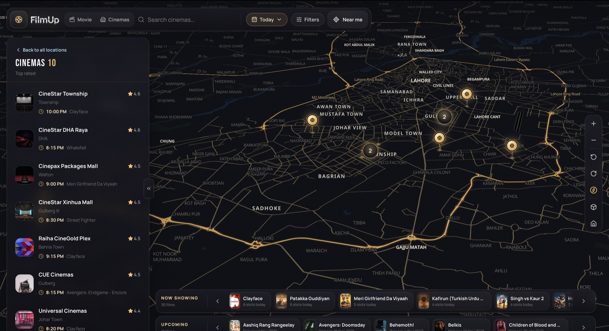
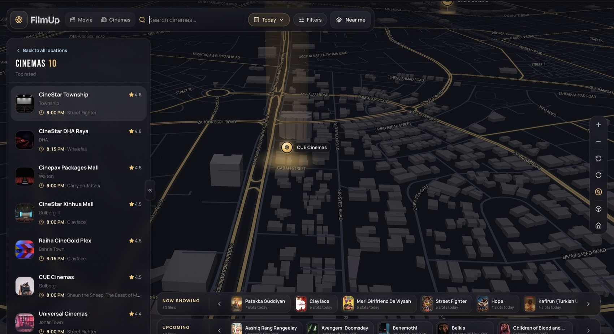
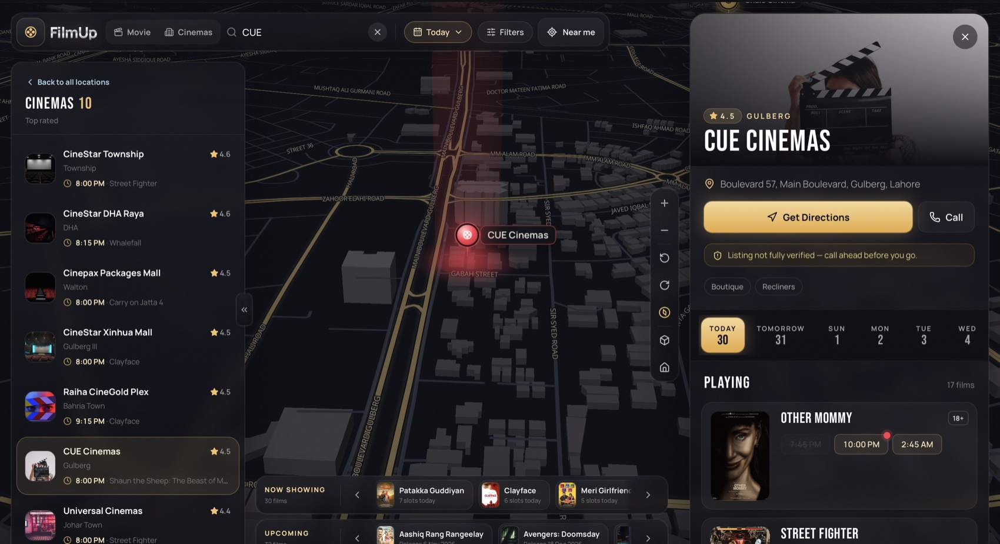
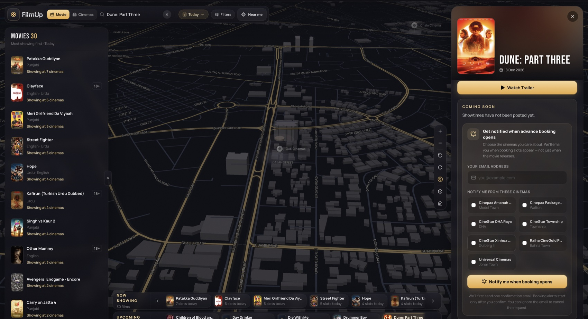
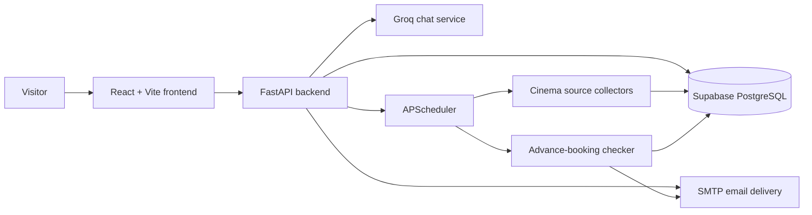

# FilmUp

**Find the show. Find the cinema. Make a night of it.**

[](https://github.com/damnalee/filmup/actions/workflows/ci.yml)

FilmUp is a Lahore-focused cinema discovery experience. It brings supported cinema locations, movie listings and available showtimes into one searchable map and directory, with email alerts for advance-booking openings on selected upcoming films.

<p align="center">
  
</p>

<p align="center">
  <strong>React · TypeScript · Vite · FastAPI · Supabase · MapLibre</strong>
</p>

## The problem FilmUp solves

Finding a movie time in Lahore can mean opening several cinema websites one by one, checking different booking apps, and comparing listings across separate pages. Those booking apps do not provide one dependable, concurrent view of the available slots across all the cinemas a moviegoer may want to compare. That makes a simple question — *which cinema has the best showtime for this movie?* — unnecessarily time-consuming.

**FilmUp's main objective is to bring the supported Lahore cinemas and their available movie sessions together in one place.** Instead of switching between separate websites and apps, people can explore cinema locations on a shared map, browse one consolidated cinema and movie list, and compare the showtimes that FilmUp has collected from supported sources. Upcoming titles can also be followed with advance-booking email alerts.

FilmUp is a discovery layer, not a ticket-booking marketplace: when a cinema publishes a booking link, users continue to that cinema or provider to complete the purchase. Coverage depends on the cinemas and sources currently supported by FilmUp; it does not claim to list every venue or every slot in Lahore.

## What FilmUp does

- **Explore Lahore cinemas:** discover supported venues on an interactive map and browse by cinema or area.
- **Find movies and showtimes:** search the live catalogue, inspect upcoming sessions and follow booking links supplied by cinema sources.
- **See what's coming:** browse upcoming titles even when a cinema has not published sessions yet.
- **Get advance-booking alerts:** choose one or more cinemas, confirm your email address, and receive an alert when matching future showtimes appear.
- **Use your location optionally:** browser geolocation can help find nearby venues; it is only requested after the user chooses the location feature.

FilmUp is a discovery and notification product. It does not sell tickets or guarantee that a cinema's external booking page has seats available.

## Product screens

These are captures of the actual FilmUp interface running locally, not design mockups.

### Lahore cinema mapping

The main view combines cinema markers on the map with a visible directory of supported venues and the movie ribbons along the bottom. It is designed to make the cinema options visible together instead of making people inspect each venue separately.

<p align="center">
  
</p>

### Browse the cinema directory

<p align="center">
  
</p>

### Cinemas and its showtime details

<p align="center">
  
</p>

### Upcoming movie details and advance booking alert

This single view shows the upcoming movie details and its advance-booking alert form together. A user can enter an email address, select the cinemas to watch, and confirm the subscription. FilmUp then checks for matching future sessions and emails the user when booking opens at a selected cinema.

<p align="center">
  
</p>

The screenshots were captured on 30 October 2026. Movie catalogues, release information and showtimes are live data and can change after capture.

## Architecture



The frontend and backend are maintained in one repository. The React app is at the repository root; the Python API is in `backend/`.

## Technology

| Layer | Technology |
|---|---|
| Frontend | React 19, TypeScript, Vite 8, Tailwind CSS 4 |
| Map | MapLibre GL, React Map GL, Supercluster |
| UI motion | Framer Motion |
| API | FastAPI, Uvicorn, Pydantic |
| Data | Supabase (PostgreSQL) |
| Collection | Python, HTTPX/aiohttp, BeautifulSoup, APScheduler |
| AI assistant service | Groq SDK (backend endpoint; separate from the map UI) |
| Email | SMTP with a Gmail app password or another compatible SMTP provider |

## Quick start

See the full [local setup guide](docs/SETUP.md). In short:

### 1. Requirements

- Node.js 22 or newer and npm
- Python 3.12 (recommended; see `backend/.python-version`)
- A Supabase project with the FilmUp catalogue tables
- Groq API key for the optional chat endpoint
- SMTP credentials for advance-booking confirmation and alert emails

### 2. Configure the backend

```bash
cd backend
python3.12 -m venv .venv
source .venv/bin/activate
pip install -r requirements.txt
cp .env.example .env
```

Edit `backend/.env` and set the Supabase URL/key. Set Groq and SMTP values if you use those services. Never commit `.env`.

### 3. Start the API

From `backend/`:

```bash
uvicorn main:app --reload --host 127.0.0.1 --port 8000
```

Check `http://127.0.0.1:8000/health` and `http://127.0.0.1:8000/docs`.

### 4. Configure and start the frontend

In a second terminal, from the repository root:

```bash
npm ci
cp .env.example .env.local
npm run dev
```

Open `http://127.0.0.1:5173`. Vite proxies `/api` to `http://127.0.0.1:8000` by default. To change the proxy target, set `VITE_API_PROXY_TARGET` in `.env.local`.

### 5. Build and verify

```bash
npm run typecheck
npm run build
```

For backend syntax verification and unit tests:

```bash
python -m compileall -q backend
python -m unittest discover -s backend -p 'test_*.py' -v
```

## Documentation

- [Local setup and environment variables](docs/SETUP.md)
- [Architecture and request/data flows](docs/ARCHITECTURE.md)
- [Deployment guide](docs/DEPLOYMENT.md)
- [Operations, scraping and alert behaviour](docs/OPERATIONS.md)
- [Contributing](CONTRIBUTING.md)
- [Security policy](SECURITY.md)
- [GitHub repository maintenance checklist](docs/GITHUB_MAINTENANCE.md)

## API overview

| Endpoint | Purpose |
|---|---|
| `GET /health` | API and scheduler health |
| `GET /api/movies` | Movie catalogue with future showtimes |
| `POST /api/advance-booking/subscribe` | Create a pending email-alert subscription |
| `GET /api/advance-booking/confirm/{token}` | Confirm an email subscription |
| `POST /chat` | Optional cinema assistant endpoint |
| `GET /docs` | Interactive OpenAPI documentation |

The catalogue API is the source of truth for movie/showtime data. The frontend intentionally does not invent sample movies or showtimes when the API is unavailable.

## Data and source integrity

- Cinema coordinates and area metadata are curated frontend data used to place map markers.
- Movie catalogue and showtime records are loaded from the backend and Supabase.
- Only future showtime rows are exposed as upcoming sessions.
- External booking URLs are links to cinema/provider pages; FilmUp does not complete ticket purchases.
- Scraper output, reconciliation backups and local audit exports are intentionally excluded from Git because they are operational data, not application source.

## Project status and limitations

FilmUp is an actively developed project. Cinema websites can change their markup or APIs, and a source may temporarily fail or publish incomplete information. Treat the cinema's own booking page as authoritative before travelling or purchasing tickets.

The current backend starts the scraper schedule inside the FastAPI process. A host that sleeps or restarts free services cannot guarantee scheduled scraping or five-minute alert checks. Some free hosts also block outbound SMTP. See [deployment limitations](docs/DEPLOYMENT.md) before using a free tier for real notifications.

The scraper monitoring endpoint (`/api/monitoring/scraper`) exposes operational run history. Put it behind administrator authentication or an access-controlled gateway before exposing a deployed backend publicly.

## License

No open-source license has been applied yet. Until a license is added, all rights are reserved by the project owner. Do not assume permission to reuse or redistribute this code.
