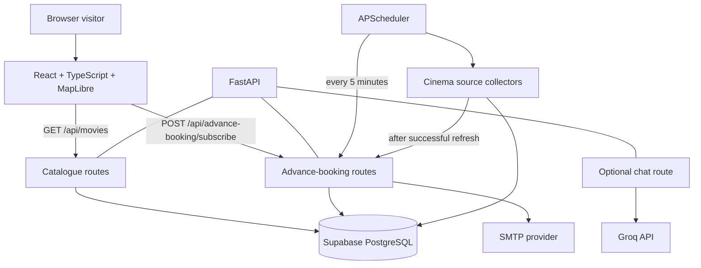
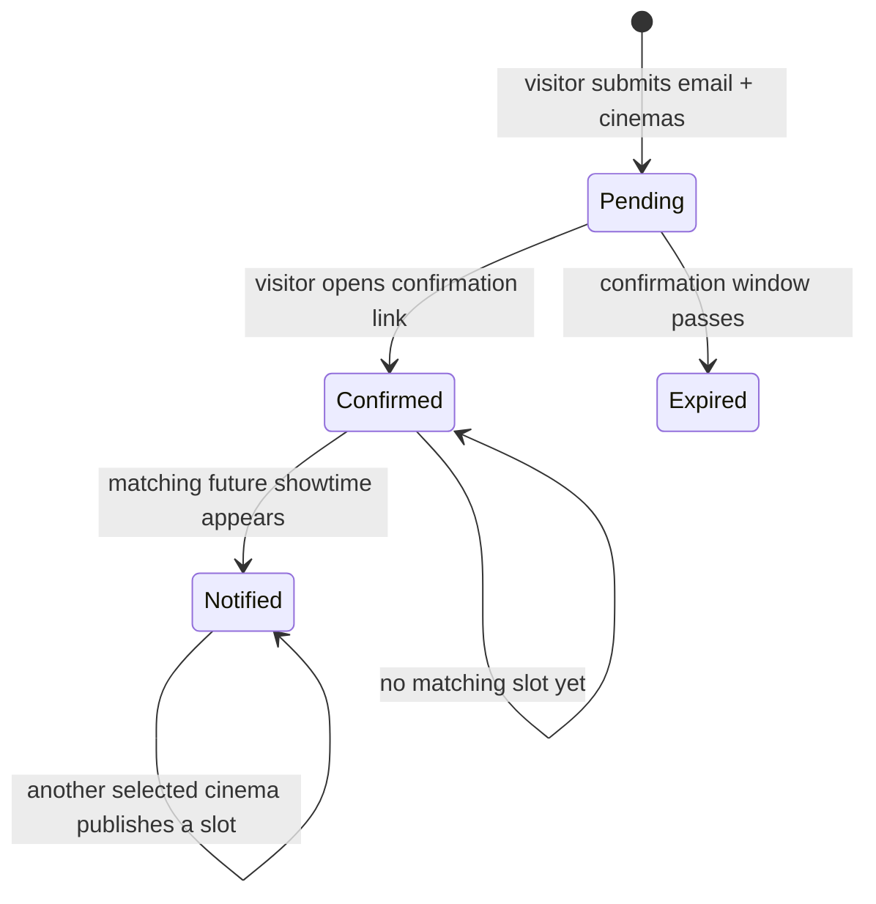

# Architecture

## System context

## Frontend

The frontend is a single-page React application. `src/App.tsx` coordinates the map, cinema/movie panels, filtering and the selected date. UI components live in `src/components/`; reusable domain logic is under `src/lib/`; the API boundary is under `src/services/`.

The map uses curated Lahore cinema coordinates and area data from `src/data/`. This static geospatial metadata is not the source of movie or showtime availability.

`src/services/dataSource.ts` requests the FastAPI catalogue and adapts backend records into the frontend's `CinemaData` model. It deliberately has no fictional movie/showtime fallback: an API failure is surfaced to the user.

## Backend

- `main.py` creates the FastAPI application, health endpoint, optional chat endpoint and APScheduler lifecycle.
- `catalog_routes.py` assembles movie catalogue entries with future showtimes.
- `advance_booking_routes.py` creates pending email subscriptions, confirms tokens and sends notifications when selected cinemas publish matching future sessions.
- `scraper.py` collects movie/showtime data from supported cinema sources, normalizes records and writes to Supabase.
- `database.py` owns the Supabase client and persistence operations.
- `location_guard.py` restricts venue handling to the supported Lahore venue allowlist.
- `chatbot.py` provides the optional Groq-backed assistant endpoint.

## Advance-booking notification lifecycle

1. Visitor chooses an upcoming movie, email address and one or more cinemas.
2. Backend stores a pending subscription and emails a time-limited confirmation link.
3. The visitor must confirm before notifications are sent.
4. Scraper updates the catalogue/showtime data.
5. The notification checker matches the movie title and selected cinema names against future showtimes.
6. An alert is sent for a selected cinema when a matching slot is found; already-notified cinemas are not sent repeatedly.

The confirmation token has a finite expiry. The database status and `notified_cinemas` field are used to avoid duplicate alerts.

## Data integrity principles

- The backend/Supabase catalogue is authoritative for listings and showtimes.
- Only future sessions are returned to the UI.
- The frontend must not fabricate showtimes or infer availability from a release date alone.
- Cinema coordinates are presentation metadata and should be checked before adding a new venue.
- Scraper audit/reconciliation output is operational evidence and is not committed to the public source repository.

## Deployment topology

Recommended split deployment:

- Vercel static hosting for the Vite frontend.
- An always-on Python web service for FastAPI.
- Supabase for persistent data.
- A reliable email API/SMTP provider for transactional messages.
- A durable scheduler/worker for scraping and notification checks.

See [Deployment](DEPLOYMENT.md) for the important free-tier caveats.
