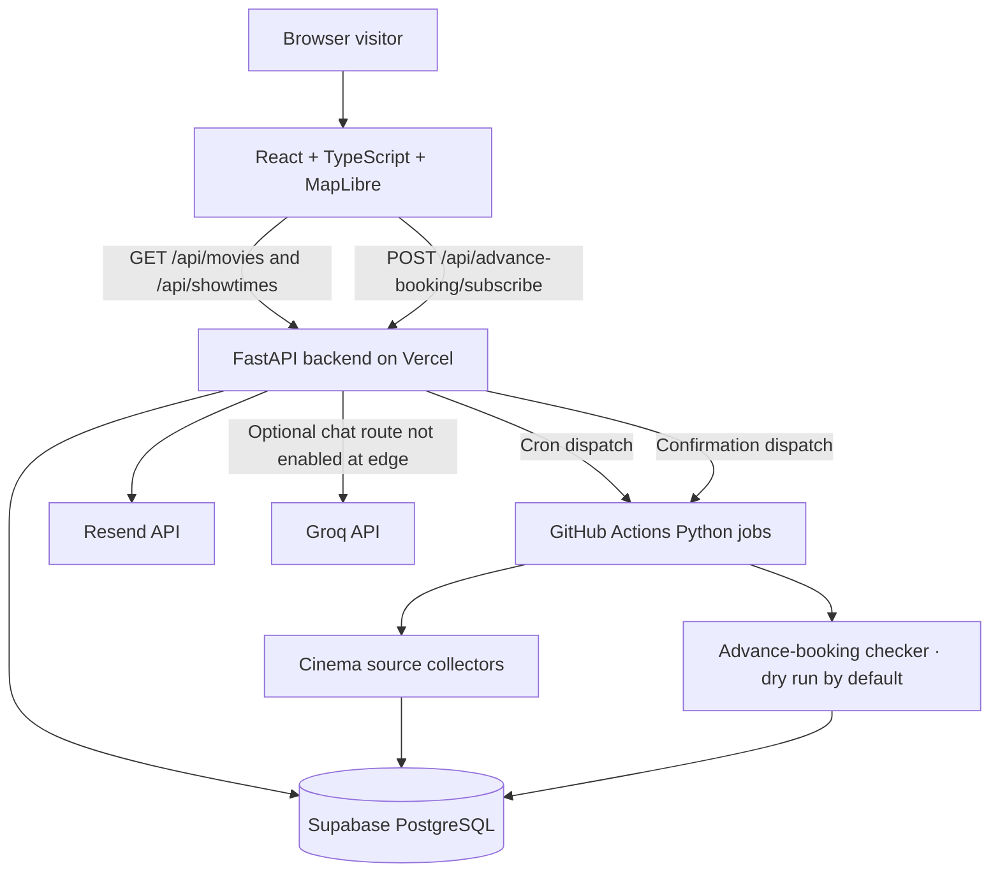
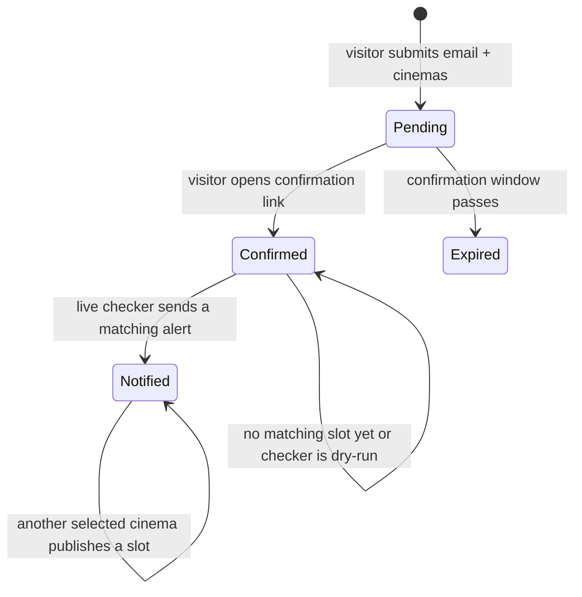

# Architecture

## System context

## Frontend

The frontend is a single-page React application. `src/App.tsx` coordinates the map, cinema/movie panels, filtering and the selected date. UI components live in `src/components/`; reusable domain logic is under `src/lib/`; the API boundary is under `src/services/`.

The map uses curated Lahore cinema coordinates and area data from `src/data/`. This static geospatial metadata is not the source of movie or showtime availability.

`src/services/dataSource.ts` requests both the movie catalogue and future showtimes from the FastAPI backend. It deliberately has no fictional movie/showtime fallback: an API failure is surfaced to the user.

## API and collection

- `backend/main.py` creates the FastAPI application for local development or Vercel. It includes the health endpoint, optional Groq chat route, catalogue endpoints and APScheduler lifecycle.
- `backend/catalog_routes.py` assembles movie catalogue entries and exposes future showtime rows.
- `backend/advance_booking_routes.py` creates pending email subscriptions, confirms tokens and checks for matching future sessions.
- `backend/scraper.py` collects movie/showtime data from supported cinema sources, normalizes records and writes to Supabase.
- `backend/database.py` owns the Supabase client and persistence operations.
- `backend/location_guard.py` restricts venue handling to the supported Lahore venue allowlist.
- `backend/chatbot.py` provides the optional Groq-backed assistant endpoint.

## Advance-booking notification lifecycle

1. Visitor chooses an upcoming movie, email address and one or more cinemas.
2. The API stores a pending subscription and sends a time-limited Resend confirmation link.
3. The visitor must confirm before notifications are considered.
4. The scraper updates catalogue/showtime data.
5. The notification checker matches the movie title and selected cinema names against future showtimes.
6. The backend notification checker matches reservations and sends only after the configured live delivery checks pass.

The confirmation token has a finite expiry. The database status and `notified_cinemas` field are used to avoid duplicate alerts.

## Data integrity principles

- The backend/Supabase catalogue is authoritative for listings and showtimes.
- Only future sessions are returned to the UI.
- The frontend must not fabricate showtimes or infer availability from a release date alone.
- Cinema coordinates are presentation metadata and should be checked before adding a new venue.
- Scraper audit/reconciliation output is operational evidence and is not committed to the public source repository.

## Deployment topology

- Vercel hosts the Vite frontend and FastAPI backend as separate services.
- Public `/api/*` requests route to the internal FastAPI service.
- Supabase stores catalogue, showtimes, subscriptions and scraper history.
- Resend sends subscription confirmation emails and booking alerts.
